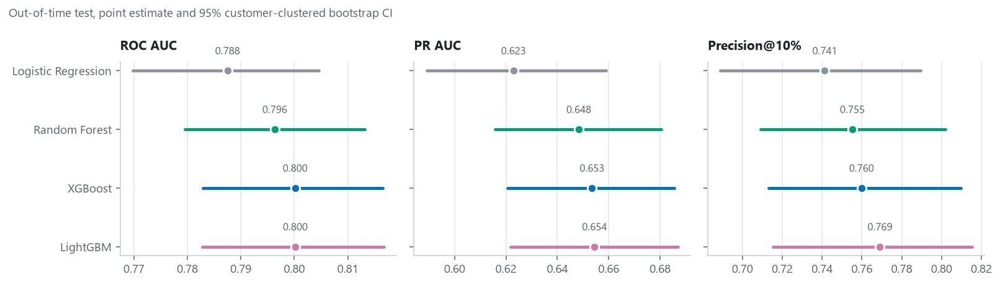
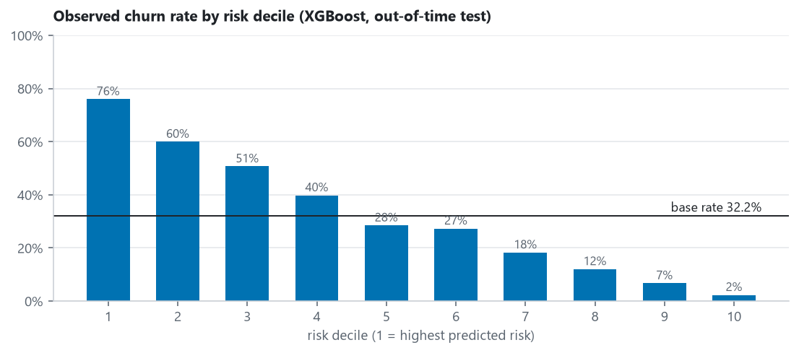
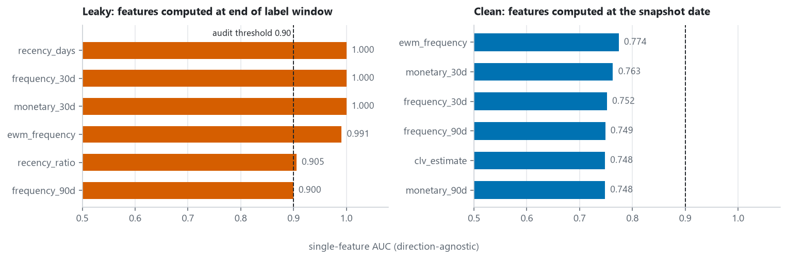
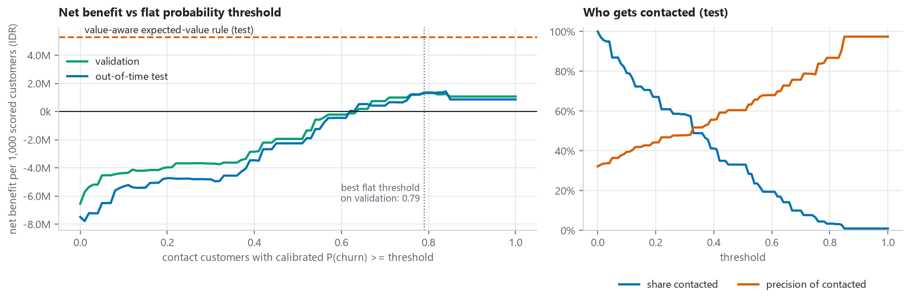
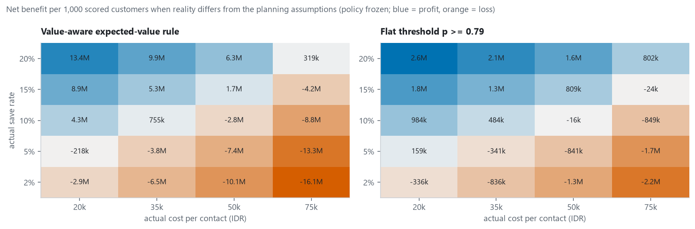

# TokoKita: Leakage-Safe Churn Prediction with Out-of-Time Validation

*Originally developed as a university course project (AI for Data & Predictive Analytics), rebuilt and extended independently.*

Predict which **active** customers of an online marketplace will place **no order in the next 30 days**, validate the model the way it would actually be used (on a future period it has never seen), and turn the scores into a retention decision that is stress-tested against its own assumptions.

[English](README.md) | [Bahasa Indonesia](README.id.md) | Notebook: [`notebooks/tokokita_churn.ipynb`](notebooks/tokokita_churn.ipynb) (executed, outputs included)

> **Everything here runs on synthetic data** from a transparent customer-lifecycle simulation. No real company, customer or transaction is involved, and conclusions are about the simulation, not about any real shop.

## Headline results (out-of-time test, synthetic data, seed 42)

| | |
|---|---|
| **Test period** | snapshots on 1 Nov, 15 Nov and 1 Dec 2024; every training and validation label window had closed before 1 Nov |
| **Best model** | XGBoost, chosen on validation (not on test): **AUC 0.800** (95% CI 0.783 to 0.817) |
| **Targeting quality** | top 10% riskiest customers churn **76%** of the time vs a 32% base rate (2.4x lift) |
| **Model ranking** | XGBoost and LightGBM tie (AUC 0.800 each); Random Forest 0.796; Logistic Regression 0.788 |
| **Probabilities** | usable as probabilities: expected calibration error 0.033 (Brier 0.166) |
| **Leakage check** | an overlapping-window evaluation inflates AUC to **0.98 to 0.99** for the same models (see below) |
| **Business value** | value-aware targeting: **+5.3M IDR per 1,000 scored customers** (95% CI 2.6M to 8.5M) *under stated assumptions*; break-even needs a retention-offer save rate of about 9% |

Out-of-time test metrics with 95% customer-clustered bootstrap intervals (1,000 resamples):

| Model | AUC | PR AUC | Precision@10% | Recall@10% | Brier | ECE |
|---|---|---|---|---|---|---|
| Logistic Regression | 0.788 [0.770, 0.805] | 0.623 | 0.741 [0.689, 0.789] | 0.231 | 0.172 | 0.037 |
| Random Forest | 0.796 [0.780, 0.813] | 0.648 | 0.755 [0.709, 0.802] | 0.235 | 0.168 | 0.034 |
| **XGBoost** | **0.800 [0.783, 0.817]** | **0.653** | **0.760 [0.713, 0.810]** | **0.237** | **0.166** | **0.033** |
| LightGBM | 0.800 [0.783, 0.817] | 0.654 | 0.769 [0.715, 0.815] | 0.240 | 0.166 | 0.033 |

Paired bootstrap on the AUC gap versus XGBoost: Logistic Regression 0.013 (95% CI 0.007 to 0.018), Random Forest 0.004 (0.001 to 0.007), LightGBM 0.000 (-0.001 to 0.001). The gaps are statistically detectable for the first two but small in absolute terms, so a simple model is a defensible production choice. (Recall@10% is capped near 0.3 by construction: the top 10% of rows can contain at most about a third of all churners at a 32% base rate.)



## The business problem

A marketplace sees repeat purchases fall and has no early-warning system, so retention is reactive. The questions:

1. Which active customers are likely to place no order in the next 30 days?
2. Which of them are worth a retention offer (email plus voucher) given its cost?
3. What threshold should marketing use, and how fragile is that recommendation?

## Data (synthetic, and how it is made)

`src/tokokita/data.py` runs a seeded **customer-lifecycle simulation** (3,000 customers, 46,323 orders, Jan 2023 to Dec 2024):

* Each customer has a latent **value tier** (low 50% / medium 35% / high 15%), an individual order rate (gamma-distributed around a tier mean) and basket size (log-normal around a tier mean).
* A latent **defection date** is drawn from an exponential lifetime. The hazard depends on tier, acquisition channel, age group and discount propensity.
* In the **20 to 60 days before defecting, the order rate winds down**, so churn leaves a behavioural trace (falling frequency, growing recency) rather than being coin-flipping noise.
* Orders are Poisson draws from a daily rate with a weekend effect and a Nov/Dec campaign lift (a mild, deliberate distribution shift for the out-of-time test).
* The hidden state (tier, defection date, ...) lives in a separate `latent` table that the feature pipeline never touches.

The same seed always yields byte-identical data (tested). The course project this grew out of also used a synthetic dataset; this generator is new and written from scratch with a similar structure (customers, orders, categories, channels, discounts), so absolute numbers are **not comparable** with the original.

## Approach

* **Unit of analysis.** One row per *active* customer (at least one order in the previous 90 days) per snapshot date, with snapshots on the 1st and 15th of every month (42,840 rows).
* **Features (35, all computed from orders up to `as_of`).** RFM (recency, 30/90-day frequency and spend, average order value, spend trend), behaviour (category diversity, discount rate, channel loyalty, weekend share), tempo (tenure, order count, mean inter-order gap, recency relative to the customer's own gap), momentum (7-day activity, exponentially weighted frequency), CLV decile, and one-hot demographics.
* **Label.** `churn_30d = 1` if there is no order in `(as_of, as_of + 30 days]`.
* **Purged temporal split.** Because labels look 30 days ahead, a plain date cut still leaks. Rows whose label window crosses a boundary are dropped:

| Set | Rule | Rows | Churn rate |
|---|---|---|---|
| train | `as_of + 30d <= 2024-08-01` | 28,369 | 35.9% |
| validation | `2024-08-01 <= as_of`, `as_of + 30d <= 2024-11-01` | 7,259 | 35.8% |
| out-of-time test | `as_of >= 2024-11-01` | 4,321 | 32.2% |

* **Models.** Logistic Regression (standardised), Random Forest, XGBoost, LightGBM, with fixed moderate hyper-parameters (no search; the point is a trustworthy evaluation). Model selection, calibration and the decision threshold use **validation only**; the test set is evaluated once.
* **Uncertainty.** A **customer-clustered bootstrap** (resample customers, keeping all of their snapshots together) with identical resamples for all models, so model differences are paired.
* **Calibration.** Isotonic regression fitted on validation. Raw probabilities were already close to calibrated (ECE at most 0.047), so it mainly acts as a safeguard.



## What the analysis found about leakage, and how this repo guards against it

The original coursework's first evaluation scored features computed at 1 December against a label describing November. Those features already contained the outcome: a customer with no November order necessarily had `recency_days > 30` on 1 December, so one feature separated the classes perfectly (AUC 1.0). **The original analysis spotted this itself** and switched to an out-of-time evaluation with bootstrap intervals as the trustworthy measure; that discovery is the core insight carried into this project.

This rebuild turns the insight into reusable guardrails:

* `build_leaky_panel` recreates the overlapping-window mistake on the new data, so the two pipelines can be compared on identical customers and labels. Result: `recency_days` alone reaches AUC **1.000** (clean: 0.737), and the same four models reach AUC **0.978 to 0.990** instead of 0.788 to 0.800.
* `audit_single_feature_auc` is an automated check (any feature with single-feature AUC of 0.90 or more is suspect). It flags 5 features in the leaky panel (`recency_days`, `frequency_30d`, `monetary_30d`, `ewm_frequency`, `recency_ratio`) and **none** in the clean one (strongest honest feature: 0.774).
* The label window starts immediately after `as_of`, and the split is purged, so no training label is computed from orders that fall inside a later evaluation period.
* Tests (`tests/test_leakage.py`) assert these properties: features do not change when future transactions are tampered with; the label window is strictly after `as_of`; the split leaves no overlap; the audit separates leaky from clean.



Other refinements over the course version, each small but compounding: the original left a 30-day gap between features and label window (so it predicted days 31 to 60, as its own limitations note); logistic regression was unscaled; class re-weighting distorted probabilities (out-of-time ECE of 0.09 to 0.19 under its unweighted definition); ECE averaged bins without weighting; one test month only; library versions were recorded but not pinned. Here: no gap, scaled LR, no re-weighting plus calibration check, weighted ECE, three test snapshots, exact versions in `requirements.txt`.

## Business decision: which threshold?

Net benefit of contacting a customer, evaluated on realised outcomes in the test set:

```
net_benefit = sum over contacted customers of [ churned_i * save_rate * retention_value_i - contact_cost ]
retention_value_i = margin * retained_months * (trailing 90-day spend / 3)
```

**Assumptions (not measurements):** contact cost 35,000 IDR (email plus expected voucher cost), save rate 15% (share of would-be churners kept by the offer), margin 25%, 6 retained months. The earlier analysis implicitly assumed every contacted churner is saved; here the save rate is explicit and stress-tested.

| Policy (test set) | Share contacted | Precision of contacted | Net benefit per 1,000 scored customers (IDR) |
|---|---|---|---|
| Contact nobody | 0% | n/a | 0 |
| Contact everyone | 100% | 32.2% | -7,492,512 |
| Top 10% by risk | 10.0% | 75.8% | 401,260 |
| Flat threshold p >= 0.79 (best on validation) | 3.3% | 86.8% | 1,309,358 (95% CI 331,683 to 2,772,618) |
| **Value-aware expected-value rule** | 23.8% | 26.4% | **5,304,333 (95% CI 2,611,387 to 8,455,212)** |

**Recommendation.**

1. **Pilot the value-aware rule:** contact customer *i* when the calibrated churn probability satisfies `p_i >= contact_cost / (save_rate * value_i)`. In probability terms the effective threshold is about 0.06 for the highest-value quintile, 0.17 for the next, and 0.39 for the middle quintile; customers in the two lowest-value quintiles are almost never worth contacting (median break-even p of 0.93 to 1.0). One flat number is a blunt tool because customers differ in worth by roughly 40x.
2. **Do not roll out before a randomised holdout test.** The rule needs a true save rate above **9.2%** to break even. The save rate is not identifiable from observational data: a churn model predicts who leaves, not who can be persuaded to stay (that is uplift modelling).
3. **If operations need a single flat threshold,** use **p >= 0.79** (about the top 3% of customers). It earns less, but loses much less if the offer underperforms (break-even save rate 7.1%).



The sensitivity grid freezes each policy as decided under the planning assumptions and varies the *actual* save rate and cost. The value-aware rule has the larger upside and the larger downside; for example at a 5% save rate and 35,000 IDR cost it loses 3.8M IDR per 1,000 customers, versus 0.3M for the flat threshold.



## Limitations

* **Synthetic data.** Findings describe this simulation. In particular the signal strength (AUC about 0.80) is a product of the generator's wind-down mechanism, not an estimate for real shoppers.
* **One out-of-time window** of two months (3 snapshots); no repeated rolling-origin backtest.
* **Customers who simply order rarely** are labelled as churners; there is no separate "dormant versus lapsed" definition, and the original segment-specific churn windows (14/30/60 days) are not implemented.
* **Economics are assumptions.** The value-aware rule contacts mostly high-value customers whose churn probability is *below* average (precision 26% vs a 32% base rate); it pays only if the offer works on them. A uniform save rate ignores that some customers are persuadable and others are not.
* **No hyper-parameter search**, no drift monitoring, no fairness analysis, and no causal estimate of the offer effect.
* Per-snapshot rows from the same customer are correlated; the bootstrap accounts for it, but the effective sample size is closer to the number of customers (1,509 in the test set) than to the number of rows.

## How to run

Requires Python 3.12 (other 3.10+ versions should work; results were produced with the pinned versions below).

```bash
python -m venv .venv
source .venv/bin/activate            # Windows: .venv\Scripts\activate
pip install -r requirements.txt
pip install -e .                     # optional; tests and scripts also work without it

pytest                               # 18 tests, about 10 seconds
python scripts/run_pipeline.py       # about 4 minutes: figures + reports/results.json
python scripts/run_pipeline.py --save-data   # also writes the synthetic CSVs to data/ (git-ignored)

# re-execute the notebook with outputs stored
jupyter nbconvert --to notebook --execute --inplace notebooks/tokokita_churn.ipynb
```

Pinned versions: numpy 2.5.4, pandas 3.0.6, scikit-learn 1.9.1, xgboost 3.4.1, lightgbm 4.7.0, matplotlib 3.11.2. Results are deterministic for these versions; other library versions can move tree-model metrics slightly in the third decimal (the same effect the original course notebook documented).

## Repository structure

```
.
├── README.md / README.id.md       English (full) and Indonesian (short) READMEs
├── LICENSE                        MIT
├── requirements.txt               exact versions used for every reported number
├── pyproject.toml                 packaging and pytest config
├── src/tokokita/
│   ├── config.py                  seed, calendar, horizon, split dates
│   ├── data.py                    synthetic lifecycle generator (deterministic)
│   ├── features.py                as-of features, forward labels, snapshot panel
│   ├── splits.py                  purged temporal split + overlap assertions
│   ├── leakage.py                 leaky-pipeline reproduction + single-feature AUC audit
│   ├── models.py                  LR / RF / XGBoost / LightGBM, isotonic calibration
│   ├── metrics.py                 AUC, PR AUC, P@k, R@k, lift, Brier, weighted ECE, clustered bootstrap
│   ├── decision.py                retention economics, net benefit vs threshold, expected-value rule
│   ├── pipeline.py                end-to-end experiment shared by script and notebook
│   └── plots.py                   figures
├── scripts/run_pipeline.py        headless run -> reports/
├── notebooks/tokokita_churn.ipynb executed narrative notebook
├── reports/
│   ├── figures/                   8 PNG figures
│   └── results.json               every reported number, machine-readable
└── tests/                         18 pytest tests
```

## AI assistance disclosure

The original analysis, problem framing and findings are my own coursework. For this portfolio version I used an AI assistant (Anthropic's Claude) to help restructure the repository, write the new synthetic data generator, the package code, the tests and the documentation. I directed the work and am responsible for it, and every number in this README comes from running the code in this repository (`reports/results.json`).

## License

MIT, see [LICENSE](LICENSE).
